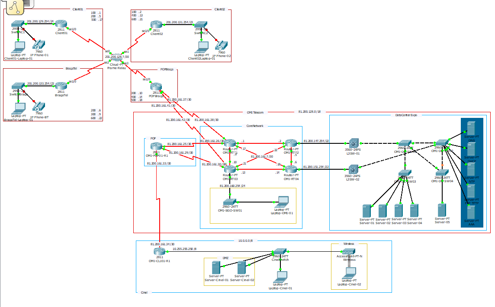
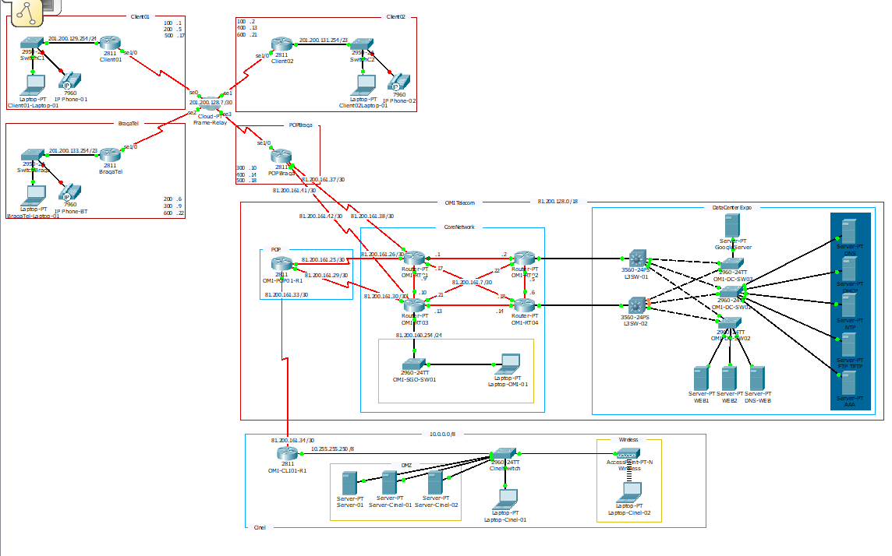

# Laboratório de Redes: ISP "OMI Telecom" (Cisco Packet Tracer)

Projeto individual do **Curso de Especialização Técnica em Gestão de Redes e Sistemas de Informação (GRSI)**, CINEL, 2012.

Desenho e implementação, em Cisco Packet Tracer, da rede de um operador fictício (OMI Telecom). A rede inclui um core redundante, um POP de acesso, um datacenter com serviços de infraestrutura, um cliente empresarial (o instituto CINEL) com NAT/PAT e DMZ, e uma rede Frame-Relay que liga clientes externos com voz e dados. O projeto foi desenvolvido em 3 iterações.

## O problema

O ponto de partida era um diagrama de alto nível, sem texto. A partir dele era preciso:

- dividir o bloco público **81.200.128.0/18** pelas várias zonas do operador;
- montar a topologia física e lógica (routers, switches L2/L3, servidores, telefones IP, wireless);
- pôr a rede a funcionar de ponta a ponta, com serviços, segmentação por VLANs e segurança.

| Zona | Equipamentos |
|---|---|
| **Core** | 4 routers (OMI-RT01 a RT04) em malha completa + rede de gestão (OMI-SGO-SW01) |
| **POP** | Cisco 2811 (OMI-POP01-R1), com ligação a RT01 e RT03 |
| **Datacenter** | 2 switches L3 Catalyst 3560 + switches de acesso 2960, servidores web, DNS, DHCP, NTP, FTP/TFTP e AAA |
| **Cliente Cinel** | Cisco 2811 com NAT/PAT (OMI-CLI01-R1), rede 10.0.0.0/8, DMZ, LAN e wireless |
| **Frame Relay** | Client01, Client02, BragaTel e POPBraga (Cisco 2811), com switches 2950 e telefones IP 7960 |

## Plano de endereçamento (subnetting)

O bloco 81.200.128.0/18 (81.200.128.0 a 81.200.191.255) foi dividido com VLSM, começando pelas redes maiores. O cálculo está em [`docs/subnetting.xls`](docs/subnetting.xls).

| Zona | Rede | Endereço de rede | Broadcast | Gama utilizável | Máscara | Hosts |
|---|---|---|---|---|---|---|
| POP | PoP1 | 81.200.128.0 | 81.200.135.255 | .128.1 a .135.254 | /21 (255.255.248.0) | 2046 |
| POP | PoP2 | 81.200.136.0 | 81.200.143.255 | .136.1 a .143.254 | /21 (255.255.248.0) | 2046 |
| Datacenter | DC1 | 81.200.144.0 | 81.200.147.255 | .144.1 a .147.254 | /22 (255.255.252.0) | 1022 |
| Datacenter | DC2 | 81.200.148.0 | 81.200.151.255 | .148.1 a .151.254 | /22 (255.255.252.0) | 1022 |
| Datacenter | DC3 | 81.200.152.0 | 81.200.155.255 | .152.1 a .155.254 | /22 (255.255.252.0) | 1022 |
| Datacenter | DC4 | 81.200.156.0 | 81.200.159.255 | .156.1 a .159.254 | /22 (255.255.252.0) | 1022 |
| Core | OMI-SGO (gestão) | 81.200.160.0 | 81.200.160.255 | .160.1 a .160.254 | /24 (255.255.255.0) | 254 |
| Core | Links ponto-a-ponto | 81.200.161.0 a 81.200.161.43 | | 2 por link | /30 (255.255.255.252) | 2 |

**Ligações ponto-a-ponto (/30):**

| Link | Rede | Ligação |
|---|---|---|
| 1 | 81.200.161.0/30 | OMI-RT01 ↔ OMI-RT02 |
| 2 | 81.200.161.4/30 | OMI-RT02 ↔ OMI-RT04 |
| 3 | 81.200.161.8/30 | OMI-RT01 ↔ OMI-RT03 |
| 4 | 81.200.161.12/30 | OMI-RT03 ↔ OMI-RT04 |
| 5 | 81.200.161.16/30 | OMI-RT01 ↔ OMI-RT04 |
| 6 | 81.200.161.20/30 | OMI-RT03 ↔ OMI-RT02 |
| 7 | 81.200.161.24/30 | OMI-POP01-R1 ↔ OMI-RT01 |
| 8 | 81.200.161.28/30 | OMI-POP01-R1 ↔ OMI-RT03 |
| 9 | 81.200.161.32/30 | OMI-POP01-R1 ↔ OMI-CLI01-R1 (Cinel) |
| 10 | 81.200.161.36/30 | POPBraga ↔ OMI-RT01 |
| 11 | 81.200.161.40/30 | POPBraga ↔ OMI-RT03 |

Os routers RT02 e RT04 ligam aos switches L3 do datacenter diretamente nas redes do DC (gateways 81.200.147.254/22 e 81.200.151.254/22). O espaço a partir de 81.200.161.44 ficou livre para crescimento.

**Redes fora do bloco do operador:**
- **Cinel**: 10.0.0.0/8 privada (gateway 10.255.255.250), com saída por NAT/PAT.
- **Clientes Frame Relay**: LANs 201.200.129.0/24 (Client01), 201.200.130.0/23 (Client02) e 201.200.132.0/23 (BragaTel), mais uma malha de PVCs ponto-a-ponto /30 em 201.200.128.0 com DLCIs 100 a 600 entre os quatro routers.

## Iterações

### Entrega 1: topologia base
[`packet-tracer/entrega-1-topologia-base.pkt`](packet-tracer/entrega-1-topologia-base.pkt)

Toda a rede montada e endereçada segundo o plano: o core em malha completa, o POP, o datacenter com dois switches L3 e quatro switches de acesso, a rede do Cinel e a nuvem Frame Relay com os clientes externos.

### Entrega 2: redundância no datacenter
[`packet-tracer/entrega-2-redundancia.pkt`](packet-tracer/entrega-2-redundancia.pkt)

Reestruturação do datacenter. Cada switch L3 passa a ligar a todos os switches de acesso, o que elimina pontos únicos de falha e aumenta a interconectividade. Foram também acrescentados servidores (WEB1, WEB2, DNS-WEB, um servidor externo de testes) e um servidor na DMZ do Cinel.

### Entrega 3: serviços, VLANs e segurança
[`packet-tracer/entrega-3-servicos.pkt`](packet-tracer/entrega-3-servicos.pkt)

- **Servidores do datacenter**: AAA, FTP/TFTP, DNS e NTP.
- **VLANs**: voz e dados nos clientes Frame Relay e no datacenter; voz, dados e wireless no Cinel.
- **DHCP**: pools para voz, dados e wireless.
- **DMZ**: servidores com endereçamento estático e NAT para serem acessíveis do exterior.
- **NAT/PAT** no router do Cinel.
- **ACLs** para controlo de tráfego.

Deixei as credenciais de acesso a cada equipamento em quadros no cisco packet tracer para se ter acesso a todas as configurações finais de cada equipamento (`show running-config`).

## Tecnologias e conceitos

Cisco Packet Tracer 5.3.3.0019 · Cisco IOS (routers 2811, switches 2950/2960/3560) · VLSM/subnetting · Frame Relay (DLCIs, subinterfaces ponto-a-ponto) · VLANs de voz e dados · telefonia IP (7960) · redundância L2 · NAT/PAT · DMZ · ACLs · DHCP · DNS · NTP · FTP/TFTP · AAA · wireless

## Como abrir

1. Instalar o [Cisco Packet Tracer](https://www.netacad.com/cisco-packet-tracer) (gratuito, com conta NetAcad).
2. Abrir o `.pkt` da iteração que queres ver. Os ficheiros foram criados na versão 5.3.3.0019.

## O que aprendi / o que faria diferente hoje
- Planear o endereçamento antes de tocar no simulador poupou muito re-trabalho
- Algumas das tecnologias e opções de segurança utilizadas poderão estar desatualizadas face às práticas atuais. Por exemplo, consideraria implementar túneis VPN com IPsec para garantir a confidencialidade e a integridade das comunicações. O Frame Relay é uma tecnologia creio que praticamente obsoleta, pelo que consideraria alternativas como VPNs sobre a Internet ou serviços VPN baseados em MPLS, dependendo dos requisitos da rede.
